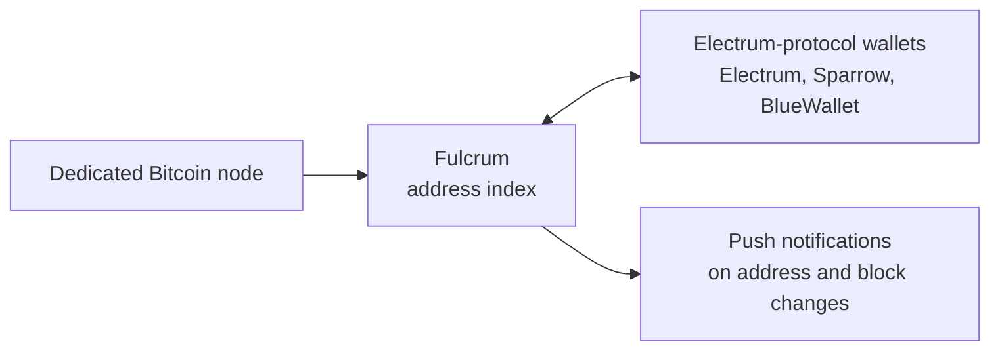

# Electrum Server

The Electrum Server add-on runs a private Electrum server built on Fulcrum alongside your dedicated Bitcoin node. It indexes every address on the chain, so any wallet that speaks the Electrum protocol can ask for a balance, a history, or spendable coins and get the answer at once. Electrum, Sparrow, BlueWallet, and wallets built on their libraries connect to it directly.


**Available on Dedicated Bitcoin nodes only,** on mainnet or testnet, in Frankfurt, Singapore, or New York. The first index build starts after the node finishes syncing and takes a few days to complete. We hand over the endpoint once it is complete.


Bitcoin Core stores the full chain but keeps no index of addresses. It cannot tell you what an arbitrary address holds or what it has received, unless that address belongs to a wallet loaded into the node itself. A wallet app serving thousands of users needs those answers for every address, in real time, and cannot get them from the node alone.

An Electrum server fills that gap. It reads every block from your node and builds an index keyed by script hash, the SHA-256 of an output's locking script. Wallets query that index instead of the node, and subscribe to the addresses they care about so changes reach them without polling.

Because the server is yours, your users' addresses go only to it. Public Electrum servers see every address a wallet looks up, along with the IP address that made the request, which lets an operator link a user's addresses. But this private server keeps that data inside your infrastructure.

### What you can do

* **Read balance and history by address:** Get the confirmed and mempool balance and full transaction history of any script hash with `blockchain.scripthash.get_balance` and `blockchain.scripthash.get_history`.
* **List coins to spend:** Fetch the unspent outputs of an address with `blockchain.scripthash.listunspent`, build a transaction, then broadcast it over the same connection with `blockchain.transaction.broadcast`.
* **Subscribe to changes:** Use `blockchain.scripthash.subscribe` and `blockchain.headers.subscribe` to receive a notification whenever an address's status changes or a new block arrives.

### Benefits

* **Any address, instantly:** The index covers every address on the chain, not only the ones you registered in advance.
* **No polling:** Subscriptions push updates to the wallet, which cuts request volume and latency.
* **User privacy:** Address lookups never leave your server, so no third-party Electrum operator can profile your users.
* **Drop-in compatibility:** Existing Electrum-protocol wallets and libraries work against it without code changes; only the server URL changes.

### When to use it

* You build or run a wallet app on the Electrum protocol and need a backend you control.
* You run a self-custody app and do not want users' addresses exposed to public servers.
* You run an exchange or payment service and need fast lookups on addresses you do not own, such as the source of a deposit.
