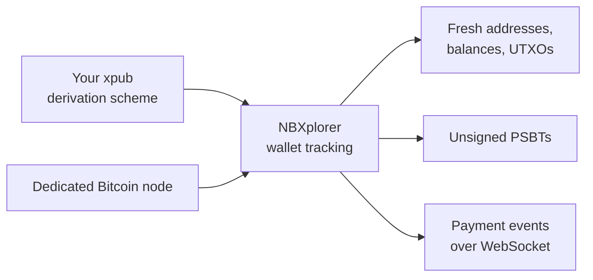

# NBXplorer

The NBXplorer add-on runs NBXplorer, the lightweight wallet backend that powers BTCPay Server, next to your dedicated Bitcoin node. You give it an [extended public key (xpub)](#user-content-fn-1)[^1], and it watches every address derived from that key: balances, transactions, unspent outputs, and new payments as they arrive. You work with entire wallets via a REST API rather than tracking addresses one by one.


Available on Dedicated Bitcoin nodes only, on mainnet or testnet, in Frankfurt, Singapore, or New York.&#x20;


An HD wallet is not one address. It is a tree of addresses derived from a single key, and a well-run payment flow uses a new one for every invoice. Bitcoin Core has no address index, so on its own it cannot tell you which of those addresses have been used, what the wallet holds in total, or when a payment lands. Building that yourself means deriving addresses, managing the gap limit, scanning blocks, and tracking confirmations.

NBXplorer does that work for you. Register a derivation scheme once, and it applies to the whole tree: it knows which addresses are used, hands out the next unused one, and reports every incoming transaction along with its confirmation count.

NBXplorer is watch-only. It needs only your xpub[^1], so private keys never touch the server. You sign PSBTs[^2] wherever your keys live: a hardware wallet, an HSM, or an offline machine.

### What you can do

* **Track wallets by xpub:** Register a derivation scheme with `derivations/{scheme}`, then read the wallet's `balance` and `transactions` in one call.
* **Get fresh receive addresses:** Call `addresses/unused` for the next unused address for each invoice, without tracking the gap limit yourself.
* **Build ready-to-sign PSBTs:** Read the wallet's `utxos`, or let `psbt/create` handle coin selection and fee estimation, then sign anywhere and broadcast.
* **Receive payment events:** Open a WebSocket with `connect`, or long-poll `events`, to receive new transactions and blocks with their confirmations.

### Benefits

* **Wallet-level API:** Balances, history, and UTXOs come back for the whole wallet, not per address.
* **Keys stay with you:** Watch-only tracking keeps signing fully under your control.
* **No address bookkeeping:** NBXplorer manages derivation and the gap limit, so address reuse and missed payments are no longer your problem.
* **Real-time settlement:** Payment events arrive as they happen, so invoices can update the moment a transaction is seen and again at each confirmation.

### When to use it

* You process Bitcoin payments and need a new address per invoice with real-time payment detection.
* You are a merchant or platform running BTCPay-style checkout on your own infrastructure.
* You run custody with keys in cold storage or an HSM and need an online system to build transactions for signing.
* You build a wallet backend and want to manage wallets through REST rather than an address index.

[^1]: An **extended public key (xpub)** is a master public key in a hierarchical deterministic (HD) cryptocurrency wallet that generates multiple receiving addresses and tracks balances without exposing private keys or allowing funds to be spent

[^2]: **Partially Signed Bitcoin Transactions (PSBTs)** are a standardized data format that lets wallets, nodes, and signing devices pass unsigned or partly signed Bitcoin transactions back and forth until they are ready to broadcast.
