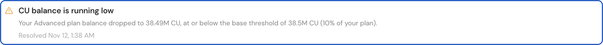
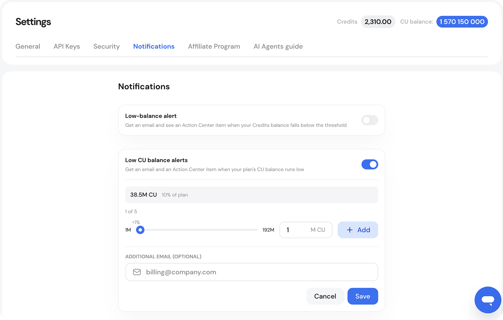

# Notifications and Alerts

GetBlock sends notifications about your account, usage, payments, and subscriptions – delivered **by** **email** and in the Account dashboard’s **Notification Center**.&#x20;

<figure><figcaption></figcaption></figure>

#### Account and security

* Account registration
* Account logins
* Creation of new access tokens
* Dedicated node deployment and activation

#### Usage and balances

* Low CU balance, based on your enabled alert thresholds
* Low Credits balance
* Insufficient Credits to complete a purchase or renew a service
* Successful Credits top-ups

#### Payments and subscriptions

* Successful payments for subscriptions, products, and CU top-ups
* Renewal reminders sent four days before eligible one-time subscriptions expire
* Failed recurring payments
* Start of a subscription grace period
* Subscription expiration
* Recurring payment cancellation

These notifications apply to the relevant Shared Node, Dedicated Node, Limitless Node, and other product subscriptions.


Email notifications are **delivered only to** **accounts** with a **verified email address** provided during registration.

Users who registered using third-party authentication methods, such as MetaMask login, may not receive email notifications.


Users can also choose whether to receive marketing communications from GetBlock. This preference can be managed in Account Settings → General by enabling or disabling the “I want to receive product updates” option.

### Low CU balance notifications

Low CU balance alerts give you time to [top up CUs](app://-/getting-started/plans-and-limits/top-up-cus-and-boost-limits) or change your plan before running out of Compute Units (CUs) interrupts your API usage.

Alerts arrive **by email** and under the **notification bell**  in the GetBlock console. Each alert shows your plan, remaining CU balance, and the threshold that triggered it.&#x20;

<figure><figcaption></figcaption></figure>

Low CU balance alerts are available on active paid plans, including one-time and recurring subscriptions.&#x20;

#### The default 10% alert

The default alert is enabled. It triggers when your remaining CU balance reaches or falls below **10% of the CU allowance included in your plan**.

For example, Starter includes 90M CU, so the default alert triggers at 9M CU remaining. The threshold stays at 9M CU after a top-up. If you change plans, the default threshold is recalculated using your new plan’s allowance.

#### Manage your alerts

Open **Settings → Notifications** in the GetBlock console to manage your low CU balance alerts.

* Turn the default 10% alert on or off.
* Configure up to **five thresholds**, each between **1% and 50%** of your plan’s included CU allowance.
* Add **one extra email address** so a teammate or billing team can also receive alerts.

If you save or enable a threshold while your balance is already at or below it, you may receive an alert immediately.

<figure><figcaption></figcaption></figure>

#### What happens when my subscription ends?

Alerts stop when your subscription ends. When you activate another eligible subscription, your previous default alert preference and any valid custom thresholds are restored.

#### What should I do after an alert?

Check your remaining CU balance and recent usage. If you expect to run out, [top up CUs](app://-/getting-started/plans-and-limits/top-up-cus-and-boost-limits) or [choose a different plan](app://-/getting-started/plans-and-limits/choosing-your-plan).

