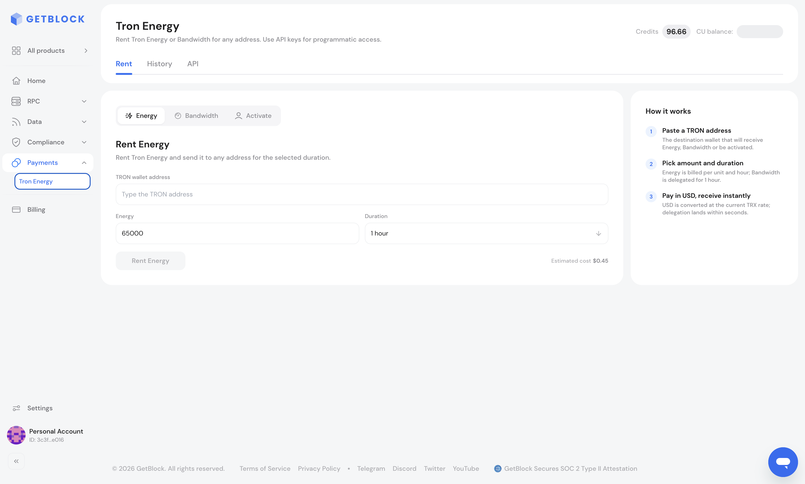
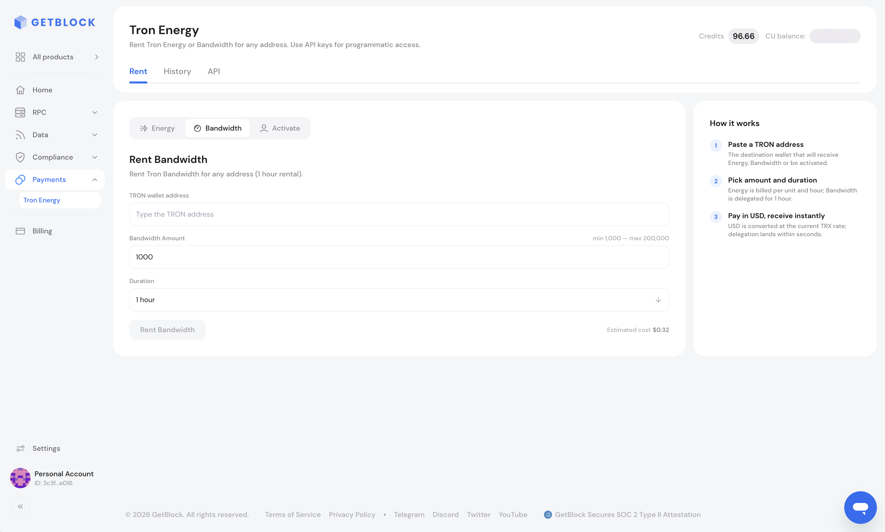
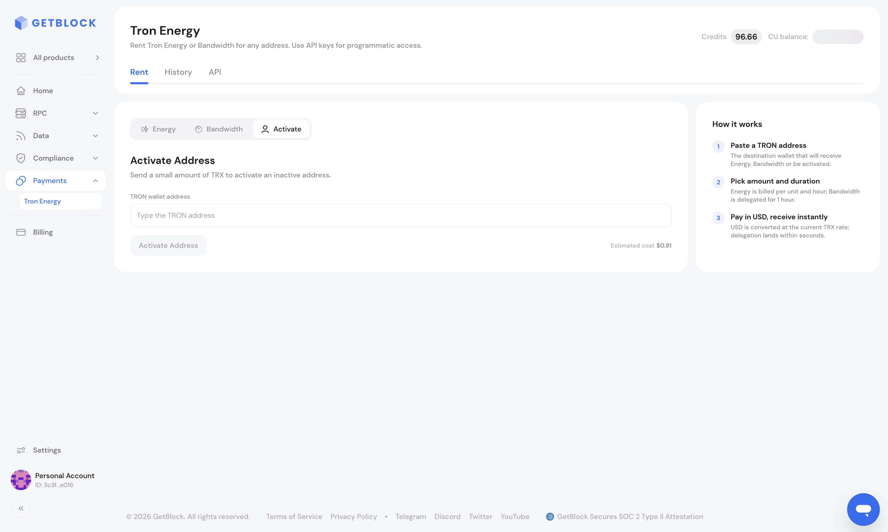
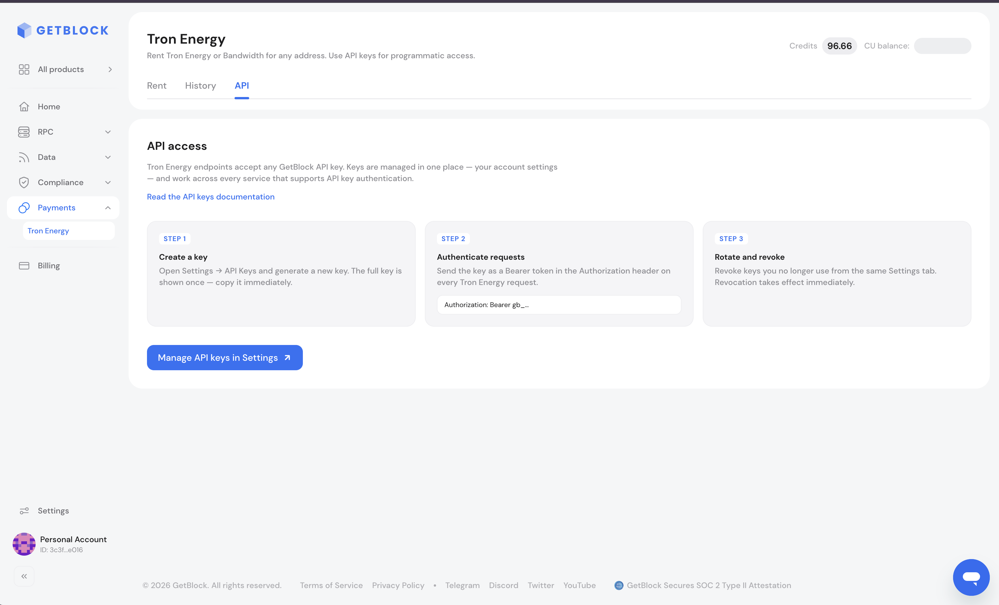

# Getting Started

In this guide, you will learn how to use Tron Energy from your GetBlock dashboard:

1. Open Tron Energy
2. Fund your Credits balance
3. Rent Energy
4. Rent Bandwidth
5. Activate an address
6. Review your history
7. Get an API key

### How to Open Tron Energy



Sign in to your [GetBlock account](https://account.getblock.io) using Gmail, MetaMask, or GitHub



In the sidebar, open **Payments** and click **Tron Energy**.

The page has three tabs:

1. **Rent** — rent Energy or Bandwidth, or activate an address
2. **History** — usage and a list of all your orders
3. **API** — how to call Tron Energy from your own code

Your **Credits** balance is shown in the top-right corner of the page.



### How to Fund Your Balance

Rentals and activations are paid from your **Credits** balance — prepaid service credits used to pay for premium features.



Click the **Credits** balance in the top-right corner of the Tron Energy page



In the panel that opens, click **Top up** and complete the payment




Your Credits balance is shared across all GetBlock products.


### How to Rent Energy

<figure><figcaption><p>Rent → Energy</p></figcaption></figure>



Go to **Rent** and select the **Energy** sub-tab



Enter the target **TRON wallet address** (starts with T, 34 characters)



Enter the **Energy** amount. A typical USDT transfer needs about 65,000 Energy, or about 131,000 if the recipient has never held USDT.



Choose the **Duration**: 1 hour, 1 day, or 3 days



Check the **Estimated cost** under the form, then click **Rent Energy**




The price grows with duration. For a single USDT transfer, 1 hour is usually enough — a 1-day rental can cost more than paying the network fee in TRX. See [Pricing](api-reference/#pricing).


### How to Rent Bandwidth

<figure><figcaption><p>Rent → Bandwidth</p></figcaption></figure>



Go to **Rent** and select the **Bandwidth** sub-tab



Enter the target **TRON wallet address**



Enter the **Bandwidth Amount** (the form shows the allowed minimum and maximum)



Leave **Duration** at **1 hour** — the only option in the dashboard



Check the **Estimated cost**, then click **Rent Bandwidth**



### How to Activate an Address

A brand-new TRON address that has never received TRX must be activated before it can receive Energy or Bandwidth.

<figure><figcaption><p>Rent → Activate</p></figcaption></figure>



Go to **Rent** and select the **Activate** sub-tab



Enter the target **TRON wallet address**



Check the **Estimated cost**, then click **Activate Address**



### How to Review Your History

Open the **History** tab to see:

* **Usage** — the number of successful rentals, filtered by 24 hours, 7 days, Month, or All time
* **History** — every order with its date, type (Energy rental, Bandwidth rental, or Wallet activation), target address, volume, price in SUN, and amount charged

### How to Get an API Key

Tron Energy endpoints accept any GetBlock API key. Keys are managed in your account settings and work across every GetBlock service that supports API key authentication.

<figure><figcaption><p>API tab</p></figcaption></figure>



Open the **API** tab and click **Manage API keys in Settings**, or go to **Settings → API Keys**



Generate a new key. The full key is shown only once — copy and store it securely right away.



Send the key as a Bearer token in the `Authorization` header of every Tron Energy request:

```bash
Authorization: Bearer YOUR_API_KEY
```



To revoke a key you no longer use, return to **Settings → API Keys**. Revocation takes effect immediately.



### Next Steps

1. [TRON Fee Model](tron-fee-model.md)
2. [API Reference](api-reference/)
3. [How to Cut USDT Transfer Fees on TRON by Renting Energy with GetBlock](../../guides/how-to-cut-usdt-transfer-fees-on-tron-by-renting-energy-with-getblock.md)
