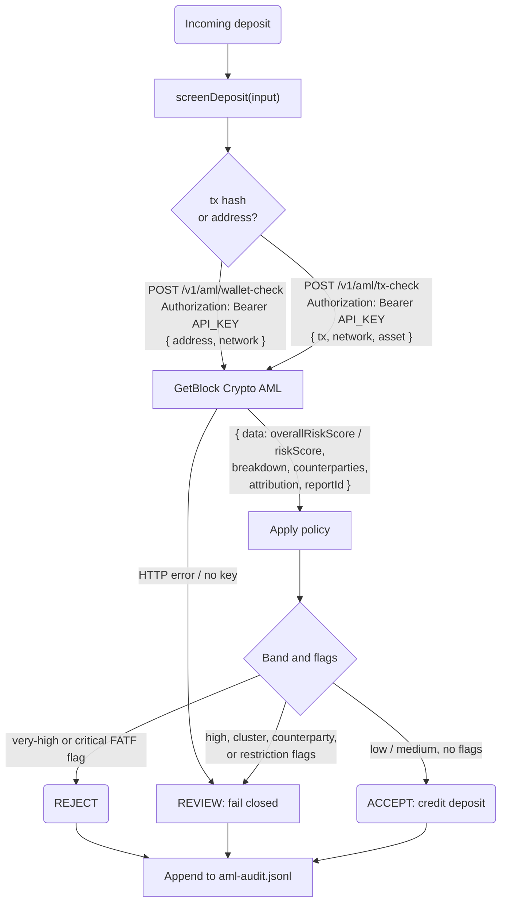

# How to Screen Crypto Deposits for AML Risk with GetBlock Crypto AML API

Once a crypto deposit lands in your wallet, you can't send it back. If those funds came from a sanctioned entity, a hack, or a darknet market, the problem is now yours. A downstream exchange may freeze your account, a regulator may ask for your screening records, and you may be left holding tainted funds. A blocklist doesn't catch this, because risky funds rarely come straight from a flagged address. They pass through clusters, mixers, and intermediate wallets first. To catch them, you need to check the sender's full on-chain history and counterparties before you credit the deposit, and keep a record of every check.

In this guide, you'll learn how to build a deposit screener with the **GetBlock Crypto AML API**. It checks a sender wallet or an incoming transaction, turns the risk report into an **ACCEPT / REVIEW / REJECT** decision, and saves an audit record for every check.

### What you'll build

A `screenDeposit({ address | tx, network, asset })` function that:

1. Sends the sender wallet to `POST /v1/aml/wallet-check`, or the deposit transaction to `POST /v1/aml/tx-check`.
2. Maps the `0–100` risk score to the documented risk bands: `low`, `medium`, `high`, `very-high`.
3. Collects the red flags: FATF flags, sanctions exposure, high-risk clusters and counterparties, and token restrictions.
4. Returns **ACCEPT**, **REVIEW**, or **REJECT**, along with the reasons.
5. **Fails closed.** If the check errors, the deposit is held for REVIEW instead of being credited.
6. Adds the request, decision, and `reportId` to an audit log (`aml-audit.jsonl`).

### How it works



## Prerequisites

* **Node.js 18+**: the project uses the built-in `fetch`.
* A [**GetBlock account**](https://account.getblock.io/): sign up with an email. No KYB or annual contract needed.
* **Prepaid credit balance**: each successful check is charged to your balance.
* A [**GetBlock API key**](https://account.getblock.io/settings/api-keys): used as the bearer token for Crypto AML requests.
* Basic JavaScript knowledge.


Crypto AML currently supports **Ethereum (`eth`)**, **TRON (`trx`)**, **Bitcoin (`btc`)**, **Litecoin (`ltc`)**, and **Bitcoin Cash (`bch`)**. See the [Overview](../crypto-aml/overview.md) for the latest list.


## Project Setup



#### Set up the project

```bash
mkdir aml-deposit-screener && cd aml-deposit-screener
npm init -y
npm pkg set type=module
npm install dotenv
```

`type=module` lets you use `import` and top-level `await`. `dotenv` is the only dependency, since `fetch` is built into Node 18+.



#### Get your API key

1. Log in to [account.getblock.io](https://account.getblock.io/).
2. Top up your balance. Web checks and API checks both draw from the same prepaid credits.
3. Go to [**Settings → API Keys**](https://account.getblock.io/settings/api-keys) and create a key.
4. Save it in a `.env` file:

```bash
GETBLOCK_AML_KEY="your_api_key_here"
```


The API key decides which account's balance gets charged. Never commit it. Add `.env` to `.gitignore`, and rotate the key from the dashboard if it leaks.




#### Make a raw API request

Before writing any code, test your key with cURL. To screen a **wallet** across every supported asset on a network:

```bash
curl -X POST "https://services.getblock.io/v1/aml/wallet-check" \
  -H "Authorization: Bearer YOUR_API_TOKEN" \
  -H "Content-Type: application/json" \
  -d '{
    "address": "0x8589427373D6D84E98730D7795D8f6f8731FDA16",
    "network": "eth"
  }'
```

| Parameter | Type   | Description                                                               |
| --------- | ------ | ------------------------------------------------------------------------- |
| `address` | string | The wallet address to screen.                                             |
| `network` | string | One of `eth`, `trx`, `btc`, `ltc`, `bch`. Not case-sensitive. |

To screen a single **transaction**, meaning one asset transfer inside it:

```bash
curl -X POST "https://services.getblock.io/v1/aml/tx-check" \
  -H "Authorization: Bearer YOUR_API_TOKEN" \
  -H "Content-Type: application/json" \
  -d '{
    "tx": "0x5c504ed432cb51138bcf09aa5e8a410dd4a1e204ef84bfed1be16dfba1b22060",
    "network": "eth",
    "asset": "usdt"
  }'
```

| Parameter | Type   | Description                                                                                                    |
| --------- | ------ | -------------------------------------------------------------------------------------------------------------- |
| `tx`      | string | Transaction hash: 64 hex characters, with or without a `0x` prefix.                                          |
| `network` | string | One of `eth`, `trx`, `btc`, `ltc`, `bch`.                                                                       |
| `asset`   | string | Optional. The transfer to screen: `eth`/`usdt`/`usdc` on Ethereum, `trx`/`usdt` on TRON. Defaults to the native coin. |


One Ethereum or TRON transaction can include both a native-coin transfer and a token transfer, and each one has its own counterparties. When you screen a USDT deposit, **always pass `"asset": "usdt"`**. Otherwise, only the ETH/TRX transfer is screened.




#### Write the API caller

Create `aml.js`. This is the only file that talks to GetBlock. It unwraps the `{ data, error }` envelope and throws on any non-OK response.


```js
// aml.js
import "dotenv/config";

const BASE_URL = "https://services.getblock.io/v1/aml";

export const NETWORKS = ["eth", "trx", "btc", "ltc", "bch"];

/**
 * POST a body to a Crypto AML endpoint and return the unwrapped `data` report.
 * Throws on any non-OK response so the caller can fail closed.
 */
async function amlRequest(path, body) {
  const apiKey = process.env.GETBLOCK_AML_KEY;
  if (!apiKey) throw new Error("Set GETBLOCK_AML_KEY in your .env file");

  const res = await fetch(`${BASE_URL}/${path}`, {
    method: "POST",
    headers: {
      Authorization: `Bearer ${apiKey}`,
      "Content-Type": "application/json",
    },
    body: JSON.stringify(body),
  });

  const json = await res.json().catch(() => ({}));
  if (!res.ok || !json.data) {
    throw new Error(`Crypto AML request failed (HTTP ${res.status}): ${json.error ?? "empty report"}`);
  }
  return json.data; // unwrap the { data, error } envelope
}

/** Screen a wallet across every supported asset on the network. */
export function checkWallet(address, network) {
  return amlRequest("wallet-check", { address, network: network.toLowerCase() });
}

/**
 * Screen one asset transfer inside a transaction.
 * On ETH and TRX, always pass `asset` — omitting it screens only the native coin.
 */
export function checkTransaction(tx, network, asset) {
  const body = { tx, network: network.toLowerCase() };
  if (asset) body.asset = asset.toLowerCase();
  return amlRequest("tx-check", body);
}
```




#### Write the decision policy

Create `policy.js`. It maps the score to the [documented risk bands](../crypto-aml/how-risk-scoring-works.md#risk-bands-and-thresholds) and then looks at the supporting evidence. The score alone isn't enough to make a decision. A wallet can have a medium score and still have a direct FATF flag, or belong to a high-risk cluster.


```js
// policy.js

/** Map a 0–100 score onto the documented Crypto AML risk bands. */
export function riskBand(score) {
  if (score >= 75) return "very-high";
  if (score >= 50) return "high";
  if (score >= 25) return "medium";
  return "low";
}

// Categories that should never be auto-accepted, wherever they appear.
const CRITICAL = new Set([
  "sanctionsExposure",
  "terrorismFinancing",
  "weaponsProliferationFinancing",
  "childAbuse",
  "humanExploitation",
  "stolenAssets",
  "hacking",
  "extortionActivity",
  "darknetActivity",
]);

/**
 * Turn a wallet or transaction report into ACCEPT / REVIEW / REJECT.
 * Tune the thresholds to your own compliance policy.
 */
export function decide(report) {
  const score = report.overallRiskScore ?? report.riskScore ?? 0;
  const band = riskBand(score);
  const reject = [];
  const review = [];

  if (band === "very-high") reject.push(`risk score ${score} (very-high band)`);
  if (band === "high") review.push(`risk score ${score} (high band)`);

  // Wallet report: direct FATF-style flags on counterparties.
  for (const flag of report.breakdown?.fatf?.flags ?? []) {
    const label = `${flag.flow}bound ${flag.category} x${flag.count}`;
    (CRITICAL.has(flag.category) ? reject : review).push(label);
  }

  // Wallet report: issuer restrictions on a token (e.g. frozen USDT).
  for (const r of report.attribution?.assetRestrictions ?? []) {
    review.push(`asset restriction on ${r.asset}`);
  }

  // Wallet report: the address sits inside a risky cluster.
  const cluster = report.attribution?.cluster;
  if (cluster?.score >= 75) {
    review.push(`member of high-risk cluster ${cluster.names?.join(", ") ?? ""}`.trim());
  }

  // Transaction report: any counterparty scoring in the very-high band.
  for (const flow of ["in", "out"]) {
    for (const [addr, s] of Object.entries(report.counterparties?.[flow] ?? {})) {
      if (s >= 75) review.push(`${flow} counterparty ${addr} scores ${s}`);
    }
  }

  // Both reports: critical categories in the exposure composition.
  const exposure = report.breakdown?.exposure ?? report;
  for (const e of [...(exposure.activityExposure ?? []), ...(exposure.complianceExposure ?? [])]) {
    if (CRITICAL.has(e.category) && e.share > 0) review.push(`${e.category} exposure ${e.share}%`);
  }

  const decision = reject.length ? "REJECT" : review.length ? "REVIEW" : "ACCEPT";
  return { decision, score, band, reasons: [...reject, ...review] };
}
```



A category's `share` is its percentage of the **exposure composition**. It is **not** a risk score, and it doesn't tell you how much that category raised the headline score. That's why the policy only uses `share` to decide whether to send a deposit for review, and never adds shares together into a score.




#### Build the screener

Create `screener.js`. It runs the right check, applies the policy, and **fails closed**: if the check fails, the deposit is held for review instead of being credited. It also adds every result to an audit log. The transaction report doesn't include the `tx`, `network`, or `asset` you sent, so the log saves the request together with the decision.


```js
// screener.js
import { appendFile } from "node:fs/promises";
import { checkWallet, checkTransaction, NETWORKS } from "./aml.js";
import { decide } from "./policy.js";

const AUDIT_LOG = "aml-audit.jsonl";

/**
 * Screen an incoming deposit before crediting it.
 * Pass `{ address, network }` for a wallet or `{ tx, network, asset }` for a transaction.
 * Fails CLOSED: if the check errors, the deposit is held for REVIEW.
 */
export async function screenDeposit(input) {
  const network = input.network?.toLowerCase();
  const kind = input.tx ? "transaction" : "wallet";
  let result;

  try {
    if (!NETWORKS.includes(network)) {
      throw new Error(`Unsupported network "${input.network}". Use one of: ${NETWORKS.join(", ")}`);
    }

    const report = input.tx
      ? await checkTransaction(input.tx, network, input.asset)
      : await checkWallet(input.address, network);

    result = { ...decide(report), reportId: report.reportId ?? null };
  } catch (err) {
    result = { decision: "REVIEW", score: null, band: "unknown", reasons: [`screening failed: ${err.message}`], reportId: null };
  }

  // The tx report does not echo the request, so store it with the decision.
  const record = { checkedAt: new Date().toISOString(), kind, request: input, ...result };
  await appendFile(AUDIT_LOG, JSON.stringify(record) + "\n");

  return record;
}
```



The audit log can contain customer wallet addresses. Add `aml-audit.jsonl` to `.gitignore`, and in production write these records to your compliance database instead.




#### Wire it into an entry point

Create `index.js`. It's a small CLI that screens either a wallet or a transaction, and exits with a non-zero code for anything other than a clean ACCEPT.


```js
// index.js
import { screenDeposit } from "./screener.js";

// Usage:
//   node index.js wallet <address> <network>
//   node index.js tx <txHash> <network> [asset]
const [mode, target, network, asset] = process.argv.slice(2);

if (!["wallet", "tx"].includes(mode) || !target || !network) {
  console.log("Usage: node index.js wallet <address> <network>");
  console.log("       node index.js tx <txHash> <network> [asset]");
  process.exit(1);
}

const input = mode === "tx" ? { tx: target, network, asset } : { address: target, network };
const r = await screenDeposit(input);

console.log(`Target:    ${target} (${network}${asset ? `/${asset}` : ""})`);
console.log(`Score:     ${r.score ?? "n/a"} (${r.band})`);
console.log(`Reasons:   ${r.reasons.length ? "\n  - " + r.reasons.join("\n  - ") : "none"}`);
console.log(`Report ID: ${r.reportId ?? "n/a"}`);
console.log(`Decision:  ${r.decision}`);

// Non-zero exit lets CI jobs or queues act on anything that isn't a clean ACCEPT.
process.exit(r.decision === "ACCEPT" ? 0 : 2);
```


In a real service, run the screener inside your deposit handler, before you update the user's balance:

```js
// inside your deposit webhook / confirmation handler
const { decision, reasons, reportId } = await screenDeposit({
  tx: deposit.txHash,
  network: "trx",
  asset: "usdt",
});

if (decision === "ACCEPT") await creditBalance(deposit);
else await holdForCompliance(deposit, { decision, reasons, reportId });
```



#### Run it

Screen a wallet:

```bash
node index.js wallet 0x8589427373D6D84E98730D7795D8f6f8731FDA16 eth
```

Screen a USDT transfer inside a transaction:

```bash
node index.js tx 0x5c504ed432cb51138bcf09aa5e8a410dd4a1e204ef84bfed1be16dfba1b22060 eth usdt
```

Expected output for a clean wallet:

```bash
Target:    0x... (eth)
Score:     12 (low)
Reasons:   none
Report ID: 3b1f0c2e-...
Decision:  ACCEPT
```

Expected output for a high-risk wallet, based on the sample report in the [API docs](../crypto-aml/run-check-via-api.md#response):

```bash
Target:    0x8589427373D6D84E98730D7795D8f6f8731FDA16 (eth)
Score:     100 (very-high)
Reasons:
  - risk score 100 (very-high band)
  - inbound sanctionsExposure x5
  - outbound hacking x17
  - asset restriction on usdt
  - member of high-risk cluster Exploit-related cluster
  - hacking exposure 12.3%
  - sanctionsExposure exposure 11.5%
Report ID: fa78dfdc-e69d-4bf6-a092-f824bbb24721
Decision:  REJECT
```

Each run also adds one line to `aml-audit.jsonl`:

```json
{"checkedAt":"2026-10-26T11:29:08.400Z","kind":"wallet","request":{"address":"0x8589…DA16","network":"eth"},"decision":"REJECT","score":100,"band":"very-high","reasons":["…"],"reportId":"fa78dfdc-e69d-4bf6-a092-f824bbb24721"}
```


Risk scores are estimates, and they change over time. The same address can score differently later as new on-chain activity, attribution data, and sanctions feeds come in. Save the `reportId` and timestamp you based each decision on, so you can explain it later.




## Understanding the response

Both endpoints return the report inside a `data` envelope. These are the fields the screener uses:

| Field                                | Type                     | What it tells you                                                                                                    |
| ------------------------------------ | ------------------------ | -------------------------------------------------------------------------------------------------------------------- |
| `schemaVersion`                      | string                   | Version of the response schema (currently `"1.0"`). Check it if your integration needs to handle future versions.               |
| `overallRiskScore`                   | number `0–100`           | Wallet reports only. The headline score: `0–24` low, `25–49` medium, `50–74` high, `75–100` very high.          |
| `riskScore`                          | number `0–100`           | Transaction reports only. The headline score for the asset transfer you screened.                                   |
| `breakdown.exposure`                 | object                   | The wallet's exposure profile. Contains its own `score` and the `activityExposure`, `complianceExposure`, `counterpartyExposure`, and `unclassifiedExposure` arrays. |
| `*Exposure[].share`                  | number                   | Each category's percentage of the exposure composition. This is **not** a risk score.                                        |
| `complianceExposure[].authorities`   | array                    | For `sanctionsExposure`, the sanctions exposure split by authority (`UK`, `EU`, `UN`).                                       |
| `breakdown.externalReports`          | object                   | Risk backed by confirmed external reports, with its own `score`.                                                      |
| `breakdown.fatf.flags`               | array                    | Direct flags on counterparties. Each one has a `flow` (`in`/`out`), a `category`, and a `count`.                                     |
| `breakdown.tokenFlags`               | object                   | Restrictions on specific tokens, such as an issuer freeze on USDT.                                                             |
| `attribution.owners`                 | string\[]                | Known entities believed to control the wallet. Only present when available.                                                    |
| `attribution.cluster`                | object                   | Cluster `names`, `score`, and exposure. A wallet with little activity of its own can still be risky because of the cluster it belongs to. |
| `attribution.assetRestrictions`      | array                    | Asset restrictions linked to the wallet.                                                                     |
| `counterparties.in` / `.out`         | object `address → score` | Transaction reports only. The addresses that sent or received the screened transfer, with each one's risk score.                    |
| `reportId`                           | string                   | The unique ID of this screening. Save it with your decision for audits.                                            |

Optional arrays, such as `flags`, `owners`, `authorities`, and `unclassifiedExposure`, only appear when there is data for them. If one is missing, the check still worked. For every category value, see the [Taxonomy](../crypto-aml/taxonomy.md).

## Troubleshooting

| Symptom                                                    | Likely cause                                                       | Fix                                                                                                         |
| ---------------------------------------------------------- | ------------------------------------------------------------------ | ----------------------------------------------------------------------------------------------------------- |
| `screening failed: Set GETBLOCK_AML_KEY`                   | `.env` is missing or in the wrong folder                         | Copy `.env.example` to `.env` in the project root and add your key.                                     |
| `HTTP 401` / `403`                                         | Invalid, revoked, or missing API key                                 | Create a new key at [Settings → API Keys](https://account.getblock.io/settings/api-keys).                 |
| `HTTP 402` or a balance error                              | Not enough prepaid credits                                         | Top up your balance in the GetBlock dashboard.                                                     |
| `HTTP 400` `Supported networks: bch, btc, eth, ltc, trx`   | The network isn't supported (for example, `sol`, `bsc`)                           | Use one of the five supported network values.                                                                   |
| `HTTP 400` on `tx-check`                                   | The hash isn't 64 hex characters, or `asset` doesn't exist on that network | Check the hash and use a valid asset: `eth`/`usdt`/`usdc` on ETH, `trx`/`usdt` on TRX.                       |
| A USDT deposit scores low, but you expected it to be flagged | `asset` was left out, so only the native coin was screened                   | Pass `asset: "usdt"` for token deposits.                                                                    |
| Score looks low but decision is `REVIEW`                   | A cluster, counterparty, FATF flag, or token restriction triggered the policy    | This is expected. Check `reasons` and look at the full report in the dashboard.                                  |
| The same address scores differently on different days                         | New on-chain activity or updated attribution and sanctions data                   | This is expected. Base each decision on the `reportId` you saved, not on a new check.                                         |

## Conclusion

You built a deposit screener that calls the GetBlock Crypto AML `wallet-check` and `tx-check` endpoints, maps the score to the documented risk bands, and combines it with FATF flags, cluster and counterparty risk, and token restrictions to return ACCEPT, REVIEW, or REJECT. It fails closed when a check can't run and saves each decision with its `reportId`, so you can explain every deposit decision later.

### Resources

* [Crypto AML overview](https://docs.getblock.io/crypto-aml/overview)
* [How risk scoring works](https://docs.getblock.io/crypto-aml/how-risk-scoring-works)
* [Run check via API](https://docs.getblock.io/crypto-aml/run-check-via-api)
* [AML risk taxonomy](https://docs.getblock.io/crypto-aml/taxonomy)
* [Run a check in the dashboard](https://docs.getblock.io/crypto-aml/run-a-check-in-the-dashboard)
* [Get an API key](https://account.getblock.io/settings/api-keys)
* [AML Deposit Screener Repo](https://github.com/GetBlock-io/guides/tree/main/aml-deposit-screener)
